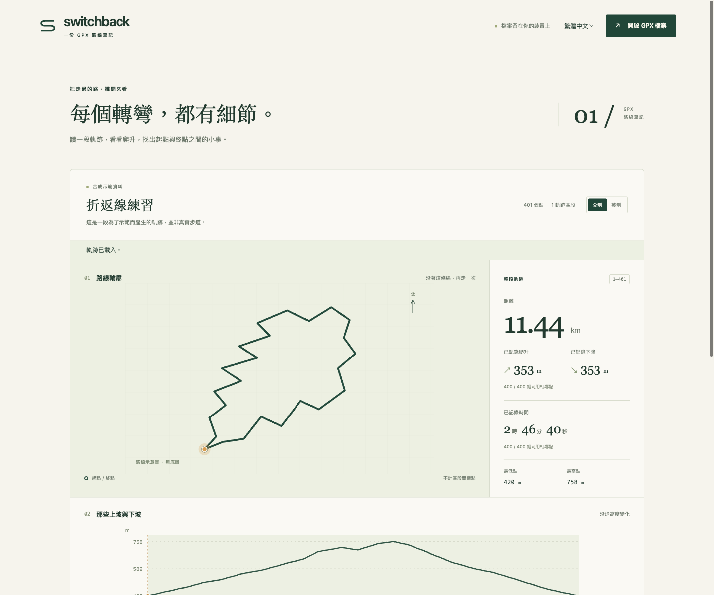

# Switchback

[Open Switchback](https://miiduoa.github.io/switchback/)
A private GPX field notebook. Inspect a route, follow its elevation, and look closer at the points between the start and finish.

[繁體中文](../README.md) · [Measurement and export definitions](measurements.zh-TW.md)



## Use it

Open or drop a GPX file. Click either chart to inspect a point, Shift-click to select a range, or use the native keyboard-accessible point slider and range inputs. Select a segment to see its distance, raw ascent/descent, usable timestamp duration, and missing-data coverage. Export the selected points as JSON or CSV. Both Traditional Chinese and English are included, with metric and imperial display units.

Files stay in the browser. There is no upload, analytics, backend, remote font, or persistent track storage. Only language and unit preferences are stored when available. The initial track is deterministic synthetic data, downloadable from the interface; it is not a real trail.

## Develop

Use Node.js 24.15 or newer within the 24.x line.

```sh
npm ci
npm run dev
npm test
npm run build
npm run preview
```

Vite serves the app under `/switchback/`. TypeScript and native SVG form the app; there are no runtime dependencies. Tests use Vitest and jsdom.

## Measurement contract

- Distance is horizontal haversine distance, with mean Earth radius 6,371,008.8 m. Track segment gaps contribute nothing.
- Ascent/descent sum raw adjacent elevation differences within a segment. Unknown elevations break the calculation. GPS noise is not smoothed. Coverage counts explain partial results.
- Recorded time sums strictly increasing adjacent timestamps in the same segment. Missing, duplicate, and backward timestamps are excluded; this is not moving time.
- The equirectangular route schematic has no basemap, terrain, roads, or navigation function. Large extents and polar tracks can distort. Charts sample roughly 1,200 points plus route endpoints; calculations use every point.
- Supports GPX 1.0/1.1 tracks (`trk/trkseg/trkpt`), prefixed namespaces, and unnamespaced track exports. Routes and waypoints are unsupported. Limits: 10 MiB, 100,000 points, 1,000 nonempty segments, elevations within ±1,000,000 m. Supplied coordinates, elevations, and timestamps must be valid. Timestamps require timezones; leap seconds are unsupported.
- Failed imports preserve the current track. When reads overlap, the last-started import wins. Switching to the demo cancels pending imports.

JSON uses SI units regardless of display units: meters for distance/elevation and milliseconds for elapsed time. Timestamps are UTC ISO strings; missing values are `null`. Point `index` and `segment` are zero-based. `selection.firstPoint` and `lastPoint` are one-based. CSV uses one-based point/segment numbers and empty cells for missing values, with explicit unit suffixes in column names. Cumulative distance always retains the original track origin, including range exports. CSV strings are quoted and formula-prefixed text is neutralized; coordinates remain numeric.

## Deploy

The workflow tests, type-checks, and builds before deploying `main` to GitHub Pages. Pull requests run checks only. Set **Settings → Pages → Source → GitHub Actions**. If the repository name changes, update `base` in `vite.config.ts`.

[GPX specification](https://www.topografix.com/GPX/1/1/) · [File API](https://developer.mozilla.org/en-US/docs/Web/API/File_API) · MIT License, Miiduoa
